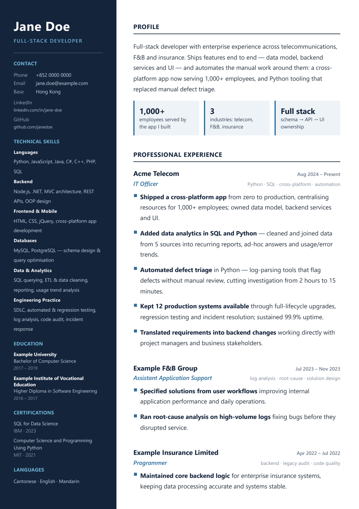
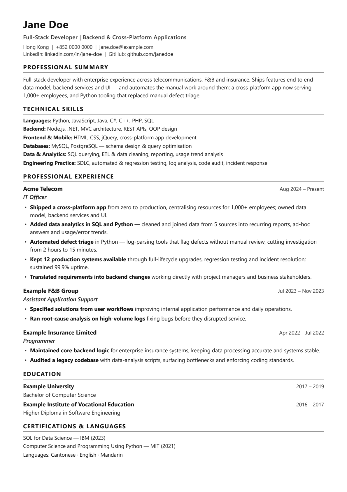

# cv-builder

[](https://github.com/tsangtp/cv-builder/actions/workflows/build.yml)

**One JSON in, two print-ready PDFs out** — a designed version and an ATS-safe version rendered from the same data.

| Designed (`modern`) | ATS-safe (`ats`) |
|---|---|
|  |  |

---

## Why this exists

Every CV builder makes you choose:

- **Pretty templates** look good in the PDF, but a two-column layout makes applicant tracking systems read your history in the wrong order — or as gibberish.
- **Plain single-column templates** parse cleanly, but look like they were typed in 2004.

So you end up maintaining two documents by hand, and they drift apart. This tool renders both from one `resume.json`, and then **checks the output** — because the failure modes here are invisible on screen.

No LaTeX, no GTK, no native PDF libraries. If you can open Chrome, you can build this.

## Quick start

```bash
git clone https://github.com/YOUR_USERNAME/cv-builder.git
cd cv-builder
pip install -r requirements.txt

cp data/example.json data/resume.json   # then edit it
python build.py                          # -> dist/your-name_cv_modern.pdf
                                         #    dist/your-name_cv_ats.pdf
python check.py dist
```

`build.py` uses `data/resume.json` if it exists, otherwise falls back to `data/example.json`, so the repo builds out of the box.

## How it works

```
resume.json  ──▶  Jinja2 template  ──▶  self-contained HTML  ──▶  Chrome --headless --print-to-pdf  ──▶  PDF
                        ▲                                                                                │
                        │                                                                                ▼
                   styles/*.css  ◀────────────────────────────────────────────────────────────  check.py
```

Two things worth calling out:

**The CSS is inlined at build time.** The generated HTML has no external assets, so it prints identically whether you run it from a repo, a temp directory, or CI. No `file://` path bugs.

**Chrome is driven as a subprocess, not a library.** This is the whole reason the project has no native dependencies. The trade-off is that Chromium occasionally exits `0` without writing a file — so `build.py` verifies the output file exists and is over 1 KB before reporting success.

## The checks

`check.py` exists because all four of these failures look fine on screen:

| Check | Catches |
|---|---|
| `page count` | A CV that spilled one line onto page two |
| `placeholders` | `[X]` you meant to fill in before sending |
| `sections` | A heading that vanished, or was split by a layout bug |
| `section order` | A side column making the text extract as *skills → education → experience* |
| `ATS readability` | Your name not being the first contiguous text an extractor sees |
| `email` | Contact details that were an image, not text |
| `links` | URLs that look right but were never embedded as links |

Exit code is `1` on failure, so it drops straight into CI.

### The gotcha that started this

The first version of the two-column layout used `letter-spacing: 1.8px` on section headings. Visually fine. But the extracted PDF text was:

```
PROFESSIONAL E XPERIENCE
CO N TAC T
```

Above roughly 1px of tracking at small font sizes, Chrome's PDF writer emits each glyph at its own position, and text extractors insert spaces between letters. Any ATS looking for `EXPERIENCE` finds nothing.

The fix was tracking of `0.5px` or less — and the `sections` check, so it never happens again silently. That check also had a bug of its own at first: it matched `EXPERIENCE` against the whole page, which hit the word "experience" in the summary prose. It now matches **short, fully-uppercase lines only**, which is what a heading actually is.

## Data format

Everything lives in one file. Required keys: `meta`, `summary`, `skills`, `experience`, `education`.

```json
{
  "meta": {
    "name": "Jane Doe",
    "title": "Full-Stack Developer",
    "tagline": "Full-Stack Developer | Backend & Cross-Platform Applications",
    "location": "Hong Kong",
    "phone": "+852 0000 0000",
    "email": "jane.doe@example.com",
    "links": [
      { "label": "LinkedIn", "text": "linkedin.com/in/jane-doe", "url": "https://www.linkedin.com/in/jane-doe" }
    ]
  },
  "summary": "Two or three sentences. No adjectives you cannot defend in an interview.",
  "highlights": [
    { "value": "1,000+", "label": "employees served by the app I built" }
  ],
  "skills": [
    { "group": "Languages", "entries": "Python, JavaScript, SQL" }
  ],
  "experience": [
    {
      "company": "Acme Telecom",
      "role": "IT Officer",
      "start": "Aug 2024",
      "end": "Present",
      "stack": "Python · SQL · automation",
      "bullets": [
        { "lead": "Shipped a cross-platform app", "body": "from zero to production, used by 1,000+ employees." }
      ]
    }
  ],
  "education": [
    { "school": "Example University", "degree": "BSc Computer Science", "start": "2017", "end": "2019" }
  ],
  "certifications": [
    { "name": "SQL for Data Science", "issuer": "IBM", "year": "2023" }
  ],
  "languages": "Cantonese · English · Mandarin"
}
```

`bullets` are split into `lead` and `body` so the first few words can be bold — a scanning anchor for the reader without turning the whole line into a label.

> **Note:** the key is `entries`, not `items`. `items` collides with Python's `dict.items()` and Jinja2 will silently render `<built-in method items of dict object>` into your PDF. Ask how I know.

## Customising

- **Colours, spacing, type** → `styles/modern.css` and `styles/ats.css`. They are plain CSS; nothing is compiled.
- **Layout** → `templates/*.html`. Plain Jinja2. Add a section by editing the template and the JSON together.
- **A third layout** → add the pair to the `TEMPLATES` dict in `build.py` and it shows up in `--template`.

Build one layout only:

```bash
python build.py --template ats
```

## Limitations

- **A4 only.** The page size is in the `@page` rule of each stylesheet; change it there if you need US Letter.
- **Chrome or Edge required.** Detected automatically, or set `CHROME_PATH`. Firefox's print engine is not supported.
- **No PDF/A, no accessibility tagging.** This is a CV, not an archival document.
- **English-first.** The templates assume left-to-right, space-separated text. CJK line breaking will need work.

## Privacy

`data/resume.json` is in `.gitignore` on purpose — your real CV should not be in a public repo. Only `data/example.json` is committed, and the screenshots above are rendered from it.

## License

MIT — see [LICENSE](LICENSE).
